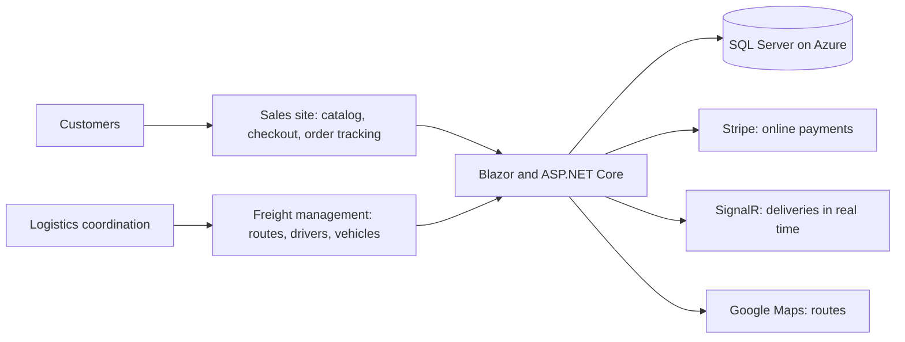

# Ferrexpress sales and freight web platform: case study

> **Private code.** The source code belongs to the client and is not published. This repository is a case study: it describes the project at a high level, with no code, no screenshots and no internal details.

| | |
| --- | --- |
| **Client** | Ferrexpress |
| **Year** | 2024 |
| **Status** | Delivered |

## Context

Ferrexpress needed an online sales channel that brought together product management and customer service, and a way to coordinate its logistics: routes, drivers, vehicles and the tracking of every delivery.

## My role

I led the development team that built these applications with .NET and Blazor, using Azure services.

## Architecture

- A sales site with an interactive catalog, online payment and order tracking.
- Freight management on the same platform: routes, drivers, vehicles and deliveries followed in real time.
- Performance and cost reports over the same data.

## Key features

- Interactive catalog
- Online payments with Stripe
- Order tracking
- Freight creation and control
- Routes, drivers and vehicles
- Real-time delivery tracking

## Stack

Blazor · ASP.NET Core · SQL Server · Azure · Stripe API · SignalR · Google Maps API

## Results

Delivered: sales, catalog, orders and freight in one place, with performance and cost reports.
